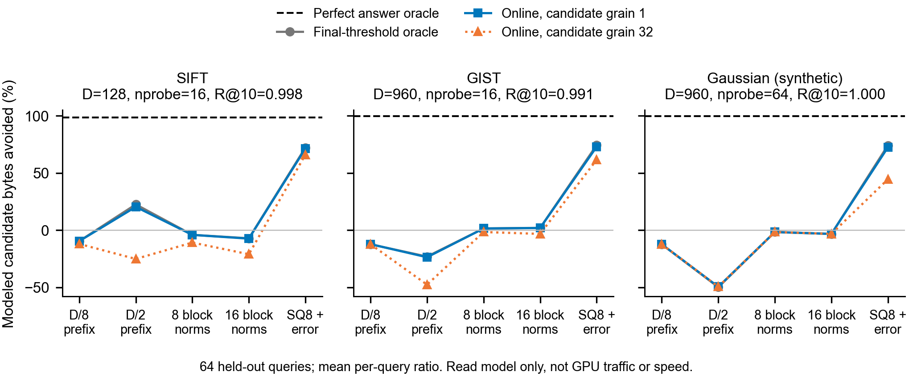

# Candidate-information frontier: bounded CPU screen

**Decision: do not build a new CUDA system from these known certificates.**
There is a large perfect-oracle ceiling, but the cheap prefix/block-norm controls
are mostly too weak after charging evidence reads. SQ8 plus residual error
reduces modeled reads, but already-established quantization controls are stronger
in this screen. No new mechanism or GPU Pareto advantage has been established.
See [DECISION.md](DECISION.md) and [nearest prior art](PRIOR_ART.md).

## Opportunity is not acceleration



**Figure takeaway:** a free answer selector greatly overstates realizable
savings; evidence cost and candidate-group expansion matter. Lines connect
categorical controls for readability, not interpolation. Each point is the mean
of 64 per-query ratios to scanning `C*(4D+8)` bytes. Negative savings mean extra
modeled reads. Perfect oracle includes IDs but omits selector cost. Gray uses
the final answer's threshold (hindsight). Online uses 64 actual seed payloads
and updates the threshold after each 64-candidate decision group. Grain 32 expands
survivors into complete 32-candidate groups; it is **not** measured warp or cache
traffic. Query/routing overhead is common and excluded. There are no timing
replicates or confidence intervals; per-query distributions are retained.
[Vector PDF](figures/opportunity.pdf) / [SVG](figures/opportunity.svg).

## Fixed routing, held-out quality and work

Calibration queries 0..31 choose nprobe from 1/4/16/64 for routing recall >=.95.
Queries 32..95 are evaluation-only; no retuning on them. The .90 target happens
to choose the same nprobe. All methods receive identical preassigned lists and
source IDs, including native rotated RaBitQ. GT is exhaustive FP64 L2 over each
**selected base prefix**, not the entire million-vector dataset.

| Evaluation subset | Base / D | nprobe | Selected-list exact global R@10 | Mean candidates |
|---|---:|---:|---:|---:|
| SIFT, real queries | 32768 / 128 | 16 | .9984375 | 8374.12 |
| GIST, real queries | 16384 / 960 | 16 | .9906250 | 5697.11 |
| Normalized Gaussian, synthetic negative control | 8192 / 960 | 64 | 1.0000000 | 8192.00 |

**Mean per-query logical read ratio to Flat (lower is better):**

| Method | SIFT | GIST | Gaussian | Quality caveat |
|---|---:|---:|---:|---|
| Free perfect-answer oracle | .01658 | .00386 | .00330 | Unrealizable selector; selected-list exact |
| D/8 prefix, online, full refetch | 1.09592 | 1.12244 | 1.12377 | Selected-list exact |
| D/2 prefix, online, full refetch | .79660 | 1.23695 | 1.49506 | Selected-list exact |
| 8 block norms, online | 1.04148 | .98559 | 1.01650 | Selected-list exact |
| 16 block norms, online | 1.07415 | .98102 | 1.03300 | Selected-list exact |
| SQ8 + error, final-threshold oracle | .27825 | .25653 | .25856 | Hindsight |
| SQ8 + error, online | .28676 | .27108 | .27573 | Selected-list exact in every tested case |
| SQ8 + error, online, grain 32 | .33975 | .38455 | .55500 | Group-expansion proxy only |
| Native PQ8 M16 + refine 128 | .06143 | .02900 | .02183 | R@10=.99844 / .87031 / .14063 |
| Native RaBitQ 1-bit + refine 128 | .07682 | .05810 | .05094 | R@10=.99375 / .99063 / .73750 |
| Native RaBitQ 4-bit + refine 32 | .18074 | .13771 | .13591 | R@10=.99844 / .99063 / .99688 |

The last row matches every selected-list top-10 ID for all 64 real SIFT and all
64 real GIST queries at these probes; it misses on 2/64 Gaussian queries. This
is bounded empirical equality, **not** an exact guarantee for the quantizer.
Every native row is a prefix of one native `k=min(128,C)` search pool, not
an independently executed native search(k=10/32). This matters for RaBitQ
because its internal one-bit filter depends on the heap threshold. `ndis` counts
post-filter code refinements for multibit RaBitQ, not candidate coverage.
The native controls are not recall-tuned on calibration data; all fixed refine
pools 0/10/32/128 and all probes are retained rather than selecting a winning
pool as a general claim. PQ emitted its native warning: 8192 training rows is
below the recommendation of 9984 for 256 centroids. It is a bounded control, not
a fully tuned high-D PQ or a strong GPU-baseline reproduction.

Native code-read bars assume every selected code plus ID is read. They do not
measure actual Faiss cache behavior or internal filtering. Real GPU IVF-RaBitQ
can avoid raw FP32 reranking altogether; an FP32-only baseline is insufficient.
The CPU byte comparison cannot establish a GPU performance ranking.

## Costs and scope

[WORK.csv](WORK.csv) is the core work ledger: candidate counts, full-payload
rows, evidence/code reads, payload reads, IDs, modeled mask/queue writes, quality
and static storage. Reads are not physical traffic. For native Flat its `code`
is the payload, counted only once. Native mask/queue writes are unknown, not
zero. Source IDs are modeled as 8 bytes per candidate for all controls.

- Prefix controls introduce no stored codes. Optimistic reuse is retained
  separately; the primary implementation refetches admitted full payloads.
- Block norms add 64/128 bytes per vector; SQ8 adds D+8 bytes per vector plus
  shared min/scale and a numerical-guard scalar. SQ8 still reconstructs and
  compares **D dimensions**; it saves input bytes, not dimension count.
- SQ8 logical storage is 21.531 / 79.166 / 39.714 MB, versus illustrative static
  budgets 22.945 / 85.312 / 42.779 MB (decimal MB). All tested certificate
  controls fit those budgets. These exclude allocator/workspace peaks.
- Native serialized sizes include centroids, codebooks and rotation; compressed
  controls with raw refinement additionally store the whole FP32 base.
- Common query input is 4D bytes and cold centroids are 64*4D bytes. Shared
  evidence parameters, query norm computation, native LUT/rotation preparation,
  and cache residency are not measured in the candidate-only read model.
- Offline encoding requires reading the raw base; only native CPU build wall
  observations are recorded. Certificate encoding time, update cost, GPU query
  preprocessing, kernel time, transactions, bandwidth, p50/p99, QPS, peak VRAM,
  warp divergence and sustained behavior are **unmeasured**.
- `RESULTS.json` contains batch sizes 1/8/32 union/mean/max payload work proxies.
  These do not determine batch completion time. `DIAGNOSTICS.json` includes
  gap quartiles and per-query survival quantiles; gap labels are never online
  selector inputs.

## Evidence and validation

[CONTRACT.md](CONTRACT.md) was frozen before measurement; hash
`a56435ec07163365133a3589b05eb42011bd1a4d512046cec45a32326a3f67c3`.
The primary source and input hashes are in [RESULTS.json](evidence/RESULTS.json)
and [INPUTS.json](INPUTS.json). Selected public base/train/query array hashes
were independently matched to pinned mirrors; original GIST archive identity is
not independently verified. Models, raw vectors, private paths, wheels and host
configuration are excluded from Git.

Primary validation covers exhaustive prefix GT, every evaluated bound,
selected-list exactness, native list identity, nonfinite rejection and negative
bound/hindsight mutations. Independent `verify.py` reconstructs distances,
assignments, thresholds, survival masks and byte ledgers without invoking the
primary selector. Verification is empirical on this finite matrix, not a proof
for all finite-precision inputs. Verification receipts specify exact replay
scope and architecture; see `evidence/VERIFICATION.*.json` and `RUN.json`.

## Reproduce (CPU only)

Use an isolated environment with Python 3.12, NumPy 1.26.4 and
`faiss-cpu==1.15.1`. No GPU package or device API is needed.

```sh
python fetch.py --out inputs/public
python check.py --inputs inputs/public --datasets SIFT GIST --out runs/real_01
python verify.py --inputs inputs/public --models runs/real_01/models \
  --evidence runs/real_01 --datasets SIFT GIST --native --report runs/replay_01.json
```

To include the synthetic control without original archive files, run this exact
generator from `prepare.py`, then omit `--datasets SIFT GIST` in a new primary
run (use a fresh output directory):

```sh
python - <<'PY'
import numpy as np
rng = np.random.default_rng(20261015)
values = []
for size in (8192, 8192, 96):
    a = rng.standard_normal((size, 960)).astype(np.float32)
    a /= np.linalg.norm(a.astype(np.float64), axis=1, keepdims=True).astype(np.float32)
    values.append(a)
np.savez_compressed("inputs/public/Gaussian.npz", **dict(zip(("x", "train", "q"), values)))
PY
```

`prepare.py` accepts explicit local benchmark files and emits all three inputs
without exporting their local paths. Primary-run and input output directories refuse overwrite.
`plot.py --root .` regenerates WORK.csv, diagnostics and figures from committed
receipts; install Matplotlib 3.10.8 for plotting. An optional locally installed
`paper-figures` style helper is used without vendoring managed runtime code.
Arm64 verification used NumPy 2.3.5; only deterministic logical receipts, not
CPU timing or cross-architecture model-training identity, are compared.

No QPS/p99 plot is provided: no GPU was allocated or accessed in this stage.
The full research brief's GPU acceptance criteria remain open, not silently
replaced by this CPU screen.
