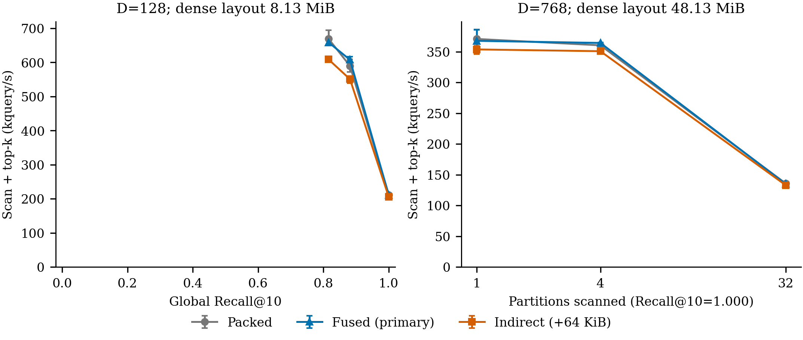
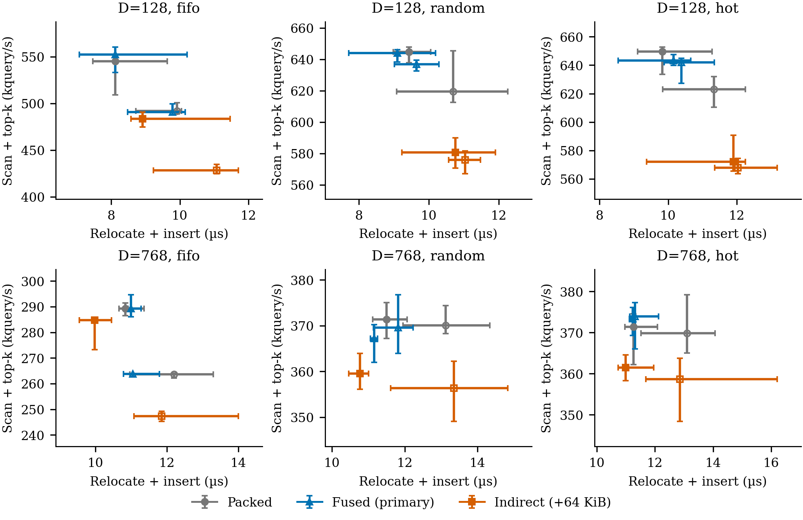

# Results: do not promote indirection as the research direction

**The refined indirect implementation does not improve the primary GPU epoch
estimator in any of the 12 tested shapes.** This is a scoped implementation
result, not a theorem against indirection, a measurement of concurrent service,
or a novel systems contribution.

The ordinary fused dense control reduces planned survivor relocations by
**73.0%–90.5%** in random/hot cases versus separate compact-then-insert.
Even after a competent one-thread-per-pointer mover, the indirect layout's
primary paired F/I ratio is **0.872–0.985**. Its best update-only F/I ratio is
**1.106**, not a qualifying end-to-end update-speedup claim.

## Exact comparison and caveats

Measured on an NVIDIA RTX PRO 6000 Blackwell Server Edition (SM 12.0),
driver 590.48.01, nvcc 13.1.115, FP32 with `-O3 -std=c++20 -arch=sm_120
-lineinfo`. The frozen launch snapshot records a 600-W limit, 2317-MHz SM and
12481-MHz memory clock; these are observations, not locked-clock guarantees.
No power or clock configuration was changed. Raw environment bytes are bound by
the public manifests; private host paths and device identity are not published.

N=8192; D=128/768; churn batch=128/1024; FIFO/random/hot; 32 queries; nprobe=4;
four fresh processes per shape; 20 warmup + 80 retained epochs. F/I>1 means
indirect is faster. The epoch is the median of each observation's update+query
sum; process ratios are aggregated geometrically. Ranges are observed process
min–max, **not confidence intervals**. All observations and order splits remain
in `SUMMARY.json` and `evidence/observations/`.

The query column uses P/I, the same-logical-order addressing contrast. F/I is
the competent combined-control contrast; fused packing can change scan order.
Host planning is outside these timers and is expensive; generation, routing,
uploads and CPU oracle costs are unmeasured. This prototype cannot establish a
GPU-resident dynamic API or sustainable churn target. FIFO starts with age/list
correlation; synthetic D=768 recall saturates, which is explicitly shown in the
figure instead of treated as representative high-dimensional quality.

| D | Batch | Workload | Update F/I | Query P/I | GPU epoch F/I [range] | I epoch wins | P→F planned survivor moves |
|---:|---:|---|---:|---:|---:|---:|---:|
| 128 | 128 | fifo | 0.884 | 0.899 | 0.884 [0.866, 0.898] | 0/4 | 128 → 128 |
| 128 | 128 | random | 0.846 | 0.902 | 0.896 [0.887, 0.909] | 0/4 | 126 → 34 |
| 128 | 128 | hot | 0.872 | 0.890 | 0.890 [0.881, 0.908] | 0/4 | 119 → 26 |
| 128 | 1024 | fifo | 0.888 | 0.870 | 0.872 [0.869, 0.877] | 0/4 | 256 → 256 |
| 128 | 1024 | random | 0.874 | 0.922 | 0.896 [0.882, 0.901] | 0/4 | 894.5 → 85 |
| 128 | 1024 | hot | 0.864 | 0.914 | 0.884 [0.872, 0.892] | 0/4 | 575.5 → 62 |
| 768 | 128 | fifo | 1.106 | 0.976 | 0.982 [0.953, 1.006] | 1/4 | 128 → 128 |
| 768 | 128 | random | 1.038 | 0.969 | 0.985 [0.969, 0.993] | 0/4 | 126 → 34 |
| 768 | 128 | hot | 1.005 | 0.977 | 0.974 [0.968, 0.979] | 0/4 | 119 → 26 |
| 768 | 1024 | fifo | 0.919 | 0.939 | 0.938 [0.922, 0.946] | 0/4 | 256 → 256 |
| 768 | 1024 | random | 0.889 | 0.960 | 0.954 [0.939, 0.971] | 0/4 | 894.5 → 85 |
| 768 | 1024 | hot | 0.863 | 0.963 | 0.946 [0.924, 0.969] | 0/4 | 575.5 → 62 |

## Correctness, quality, memory and mechanism evidence

- All declared initialization/synchronized endpoint live-ID, owner and payload
  assertions pass; selected-partition exact top-10 matches the CPU oracle.
  This does not prove unobserved intermediate states or concurrent histories.
- Small D=128/768 memcheck and synccheck each report zero errors. Two bounded
  1000-retained-epoch stress cases pass their declared checks. These are not
  broad sanitizer coverage, formal safety or a long-running service result.
- Global Recall@10 matches across layouts for every tested quality point;
  all-list scans have recall 1.0 against the synthetic oracle.
- Every layout reserves the same 16384-row payload budget; indirection adds
  64 KiB. Common staging/scratch is explicit per shape in `SUMMARY.json`.
  No per-variant process-peak VRAM claim is made while layouts coexist.
- `TRACE_SUMMARY.json` is a separate CUPTI diagnostic. Scan includes distance
  and local top-k, so its duration is not a bandwidth attribution. The raw
  trace stays off Git; its durations are not the latency denominator.
- Initial source/summary/manifest and the inefficient-mover patch are retained;
  the standard launch refinement is not called novelty and its earlier negative
  timing is not silently rewritten into the refined campaign.

## Figures

Captions and vector PDF/SVG outputs are in `figures/`. Error bars are observed
four-process ranges; these are not cuVS, real-data, or concurrent-service frontiers.
